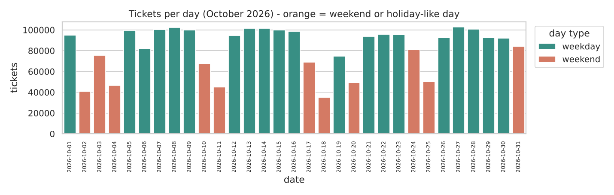
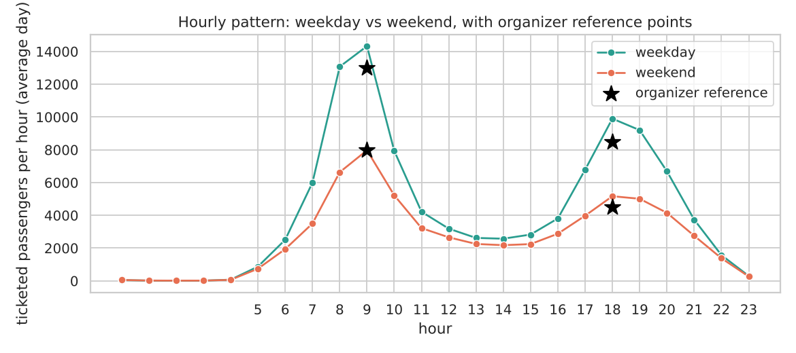
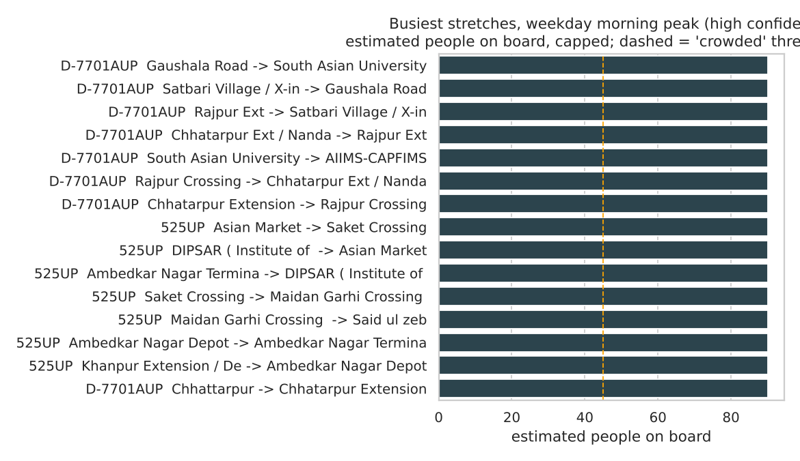
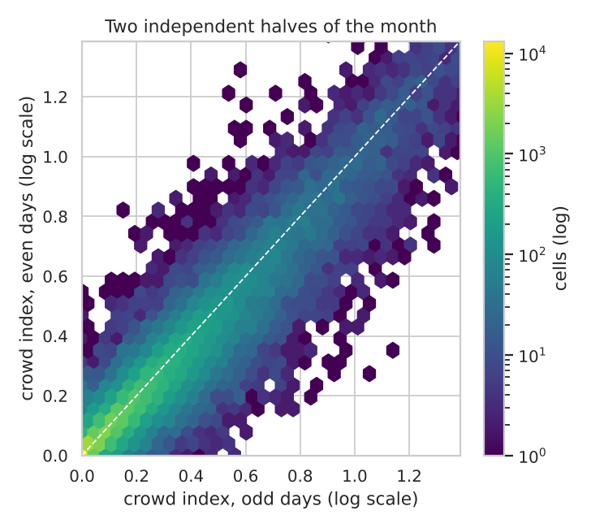
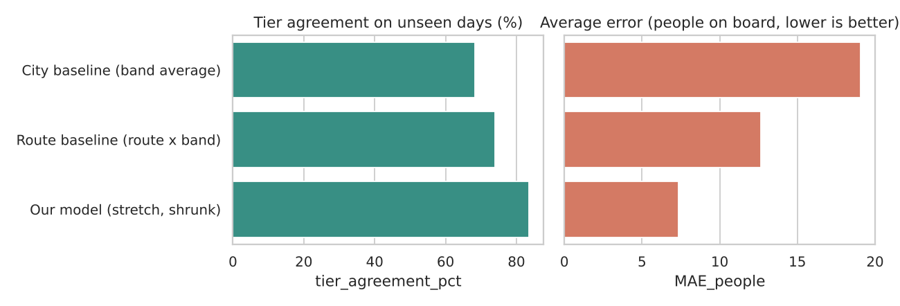
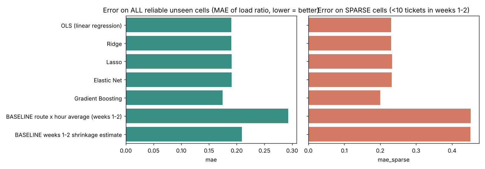
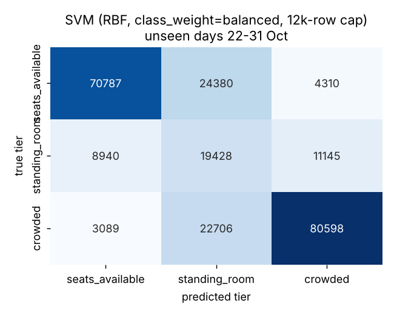

# CrowdWise Delhi - a crowd-aware bus journey planner
### Project report - Transport Stack Hackathon 2026 (Delhi), Problem 2 / Phase 1

*Team: [names] - Backend and ML: [name] - Frontend: [name]. All figures and numbers in this report come from runs on the real October 2026 data (files in `outputs/`).*

---

## 1. Summary
Commuters rank bus options by time and changes, but a packed bus is slow to board and hard to stand in. We turn **2,559,899 bus e-tickets** and the **static GTFS timetable** into an estimate of **how full a bus is for every route, stretch, hour and day type**, show it as *seats available / standing room / crowded* next to each journey option, and let the traveller choose between a faster and a more comfortable trip, or leave 15-30 minutes later. An operator view lists the most overloaded routes and hours. The estimate is validated on days it never saw (**83.5% tier agreement**), a machine-learning layer fills thin cells, and every number carries a confidence flag.

## 2. The data - and three facts that shaped the design
1. **About 48.5% of tickets have no vehicle number.** The organizers asked us not to drop them. We estimate crowding per *(route, stretch, hour, day type)*, not per physical bus, so every ticket counts.
2. **The route name already contains the direction** (`8UP`, `8ADOWN`), and the GTFS has one pattern per direction.
3. **The file is a sample of riders** (mobile e-tickets, about 3-4% of ridership, no pass holders). Rebuilding bus trips from it gave 600,380 "trips" with a median of **1 ticket** (figure `03_tickets_per_trip.png`), so trip reconstruction was dropped and raw counts are never shown as occupancy.


*Two weekdays (2026-10-02, 2026-10-20) sell about half the usual tickets; they are treated like weekend days.*

## 3. Architecture
```
raw tickets (CSV) --+                                         +--> crowd table (hourly, Parquet) --> REST API --> CrowdWise frontend
                    +--> stop matching --> locate tickets --> demand per stretch/hour                       ^
static GTFS --------+--> route patterns --> scheduled buses (supply) --+                                   |
                                                                       +--> calibration + confidence ------+
                                                         ML fallback (temporal split) for thin cells
```

## 4. Method
(Steps in `docs/TECHNICAL_NOTE.md`, code in `src/`.)
- **Stop matching:** 87.5% of name uses matched to a stop on the right route (exact + aliases 69.5%, partial 9.2%, fuzzy 8.8%). 89.5% of tickets are usable.
- **Crowd index** = ticketed riders / scheduled buses, with each ticket spread over the stretches it travelled and shifted in time by the timetable.
- **Calibration:** x 42.9 (assumption: 3.5% capture, 1.5 pass multiplier; low/high scenarios tested), compared with AC / non-AC capacity.
- **Confidence and fallback:** stretch-hour -> route-hour -> route-band -> city; 30+ tickets high, 10+ medium.


*Ticketed passengers per hour: weekday morning and evening peaks and flatter weekends match the organizers' curve.*


*Busiest stretches on weekday mornings (high-confidence cells only).*

## 5. Validation
| Test | Result |
|---|---|
| Temporal holdout (1-21 Oct -> unseen 22-31 Oct) | **83.5%** tier agreement, error 7.4 people; baselines: route average 73.9% / 12.6, city average 68.4% / 19.1 |
| Split-half reliability | rank correlation 0.935 (0.960 with 30+ tickets); same level in both halves 85.6% |
| Shrinkage | reliability 0.894 -> 0.935 |
| Calibration sensitivity (seats/standing/crowded %) | low 97.9/1.1/1.0 - base 91.6/3.5/4.9 - high 84.4/5.7/10.0 |
| Organizer curve check | weekday peaks within about 10-15% of the organizers' figures (table in the technical note) |

 

**What we can claim:** the index is stable, robust to our end-stop assumption, plausible (peaks, weekday vs weekend), and honest about thin data. **What we cannot claim:** that "crowded" means an exact head-count - that needs on-board counts or GPS.

## 6. Machine learning
We used machine learning where it helps the product - **estimating cells with few tickets** - and kept the learning notebooks (05-07) for understanding the methods.
- **Strict temporal split:** features from weeks 1-2, training target week 3, test on unseen 22-31 Oct. Winsorising and scaling are fitted on training rows only.
- **Regression (load ratio):** OLS, Ridge, Lasso, Elastic Net, Gradient Boosting. **Classification (tiers):** KNN (k chosen on a validation split), SVM (class-balanced, row cap).
- **Fallback:** for cells with under 10 tickets the API uses the ML prediction because it beat the baselines on sparse cells; the API labels each segment `observed_tickets`, `ml_fallback` or `route_average`. 65.1% of stretch-hours are served by the fallback.
- **Caveat:** the sparse-cell test favours the model (see technical note, section 6).

 

Teaching notebooks: regression models compared on a random split *and* on unseen routes (best on unseen routes: Gradient Boosting); classification (best: Random Forest); K-Means + PCA on 796 routes (silhouette 0.243 - the groups overlap, which we say openly).

## 7. The API and planner
Eight endpoints (`docs/API_CONTRACT.md`): health, stop autocomplete, plan, routes, route crowd, operator hotspots, validation summary, ML insights. Plans take about 0.1 s. Each option has total / in-vehicle / wait / walk time, transfers, worst and average crowd tier, load ratio, confidence, `prediction_source`, ticket count, per-leg stop sequences and map paths, and departure-shift suggestions.

## 8. Limits and future work
Calibration assumptions; weekend timetable missing in GTFS; bus size unknown; unmatched names (6.1%); no real-time or event data; ML evidence caveat. **Future:** validate against GPS or on-board counts, alias table for unmatched names, several stop patterns per route, multi-transfer planning.

## 9. Reproducibility
`python run_all.py` rebuilds everything from the two raw files (about 15-20 minutes); `python -m pytest -q tests` runs 16 tests; the API starts with `uvicorn planner.app:app`. Everything is in one repository; assumptions are in `config.py`.

## 10. Credits
Claude (Anthropic), Gemini and Google AI Studio were used as AI assistants; open-source libraries are listed in the README. The simulated data from the AI Studio prototype is not used anywhere.

---
<div style="page-break-before: always"></div>

## Last page - ML concepts used in this project
- **Train / test split** - Hide part of the data while the model learns, then score it on the hidden part, so we test understanding and not memory. *Example: A student practises on past papers and is judged on a new paper.*
- **Temporal split** - Train on the past and test on the future, never the other way round, so no future information leaks into training. *Example: Predict next week's bus crowding from the previous three weeks only.*
- **Feature scaling (StandardScaler)** - Rescale every column to a similar range so no column dominates only because its numbers are bigger. *Example: Distance in km and hour of day are put on the same scale before KNN measures 'closeness'.*
- **Winsorizing** - Cut extreme values back to the 1st and 99th percentile of the training data so a few huge numbers cannot distort the model. *Example: One day with a ticket-system glitch is capped instead of ruining the average.*
- **Linear Regression (OLS)** - Fits the best straight line (a weighted sum of features) through the data to predict a number. *Example: Predicting house price from size, bedrooms and age.*
- **Ridge and Lasso (regularisation)** - Linear regression with a brake: Ridge shrinks all weights, Lasso can shrink some to exactly zero, which also selects features. *Example: A teacher who stops you explaining a result with too many reasons.*
- **Elastic Net** - A mix of Ridge and Lasso, useful when several features overlap. *Example: Latitude, longitude and distance to the centre all describe 'where', so their weights are shared sensibly.*
- **KNN (K-Nearest Neighbours)** - To predict a new case, look at the K most similar known cases and let them vote (or average them). *Example: Judging a restaurant by the ratings of the 10 most similar ones nearby.*
- **SVM (Support Vector Machine)** - Draws the boundary between classes with the widest possible safety margin; with a kernel the boundary can curve. *Example: Separating spam from normal mail with the cleanest dividing line.*
- **Decision Tree** - A flow-chart of yes/no questions that ends in an answer; easy to read but can memorise noise if too deep. *Example: A doctor's triage chart.*
- **Random Forest** - Many different trees vote and their answers are averaged, which is steadier than any single tree. *Example: Asking 200 people to guess the sweets in a jar and taking the average.*
- **Gradient Boosting** - Builds trees one after another, each fixing the mistakes of the previous ones. *Example: A student who redoes only the questions they got wrong, round after round.*
- **Logistic Regression** - A linear model that outputs the probability of each class instead of a number. *Example: A bank estimating the chance a loan will be repaid.*
- **Naive Bayes** - Classifies using probabilities and pretends the features are independent, which makes it very fast. *Example: Spam filters multiply the probabilities of the words in a mail.*
- **K-Means clustering** - With no labels, groups similar items by repeatedly moving K group centres to the middle of their members. *Example: Grouping bus routes into 'morning commuter' and 'all-day' types.*
- **PCA (Principal Component Analysis)** - Squeezes many columns into a few new ones that keep most of the information, so data can be drawn on a 2-D plot. *Example: Plotting routes described by six numbers on a single flat map.*
- **Cross-validation** - Repeats the train/test experiment several times on different hidden parts and averages the scores, so one lucky split cannot fool us. *Example: Five mock exams instead of one.*
- **GridSearchCV (hyper-parameter tuning)** - Tries every combination of a model's settings with cross-validation and keeps the best. *Example: Trying several oven temperatures and times to find the best cake.*
- **Overfitting** - The model memorises the training data and does worse on new data; shown by a big gap between train and test scores. *Example: Learning last year's answers by heart instead of the subject.*
- **MAE, RMSE and R2** - MAE is the average size of the error, RMSE punishes big errors more, R2 is the share of variation explained (1 perfect, 0 no better than the average). *Example: An exam score shows how far off you were on average.*
- **Accuracy, macro-F1 and confusion matrix** - Accuracy is the share of correct labels; macro-F1 treats every class equally, even rare ones; the confusion matrix shows which classes get mixed up. *Example: A spam filter that is 95% accurate but never catches a rare scam would score poorly on macro-F1.*
