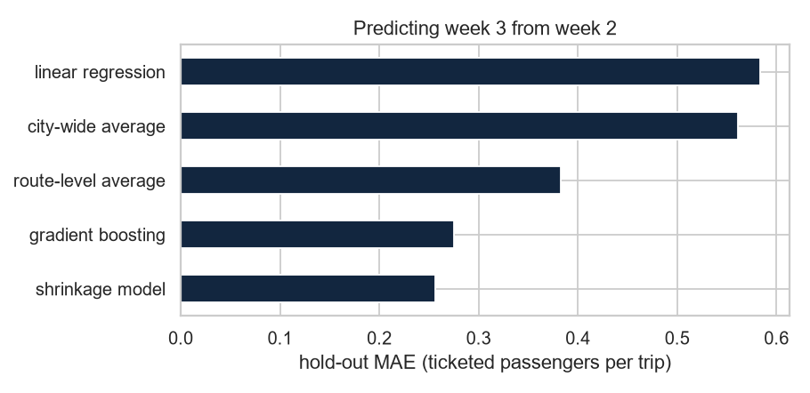
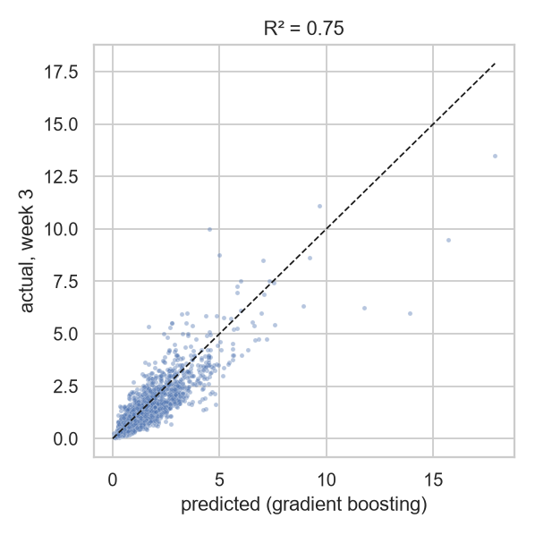
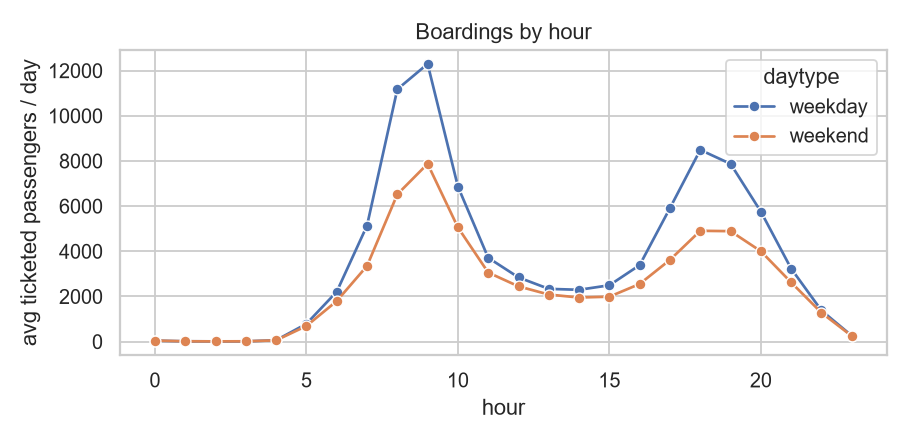

# Validation summary (auto-generated)

```json
{
  "coverage_factor": 24.745,
  "n_test_cells": 121120,
  "holdout": {
    "shrinkage model": {
      "MAE": 0.2565,
      "RMSE": 0.4541,
      "R2": 0.7781,
      "Spearman": 0.8393
    },
    "route-level average": {
      "MAE": 0.3827,
      "RMSE": 0.6558,
      "R2": 0.5372,
      "Spearman": 0.7043
    },
    "city-wide average": {
      "MAE": 0.5608,
      "RMSE": 1.0351,
      "R2": -0.1532,
      "Spearman": 0.3257
    },
    "linear regression": {
      "MAE": 0.5836,
      "RMSE": 0.8565,
      "R2": 0.2105,
      "Spearman": 0.644
    },
    "gradient boosting": {
      "MAE": 0.275,
      "RMSE": 0.4809,
      "R2": 0.7511,
      "Spearman": 0.9043
    }
  },
  "stability_spearman_W2_vs_W3": 0.9155,
  "level_accuracy_shrinkage": 0.8923,
  "level_accuracy_gradient_boosting": 0.8728,
  "skill_shrinkage_vs_route_baseline": 0.3298,
  "peak_hours_weekday": [
    9,
    8,
    18
  ],
  "sensitivity_crowded_share_range": [
    0.004,
    0.091
  ],
  "base_level_shares": {
    "seats": 0.952,
    "standing": 0.023,
    "crowded": 0.025
  },
  "share_low_confidence_cells": 0.6211,
  "n_crowd_cells": 547587,
  "mode": "real",
  "ARENA_SCORE": 0.6743
}
```

|                     |    MAE |   RMSE |      R2 |   Spearman |
|:--------------------|-------:|-------:|--------:|-----------:|
| shrinkage model     | 0.2565 | 0.4541 |  0.7781 |     0.8393 |
| route-level average | 0.3827 | 0.6558 |  0.5372 |     0.7043 |
| city-wide average   | 0.5608 | 1.0351 | -0.1532 |     0.3257 |
| linear regression   | 0.5836 | 0.8565 |  0.2105 |     0.644  |
| gradient boosting   | 0.275  | 0.4809 |  0.7511 |     0.9043 |





## Sensitivity to the coverage factor
|   coverage_multiplier |   seats |   standing |   crowded |
|----------------------:|--------:|-----------:|----------:|
|                  0.5  |   0.989 |      0.007 |     0.004 |
|                  0.75 |   0.972 |      0.014 |     0.013 |
|                  1    |   0.952 |      0.023 |     0.025 |
|                  1.5  |   0.903 |      0.041 |     0.056 |
|                  2    |   0.853 |      0.056 |     0.091 |